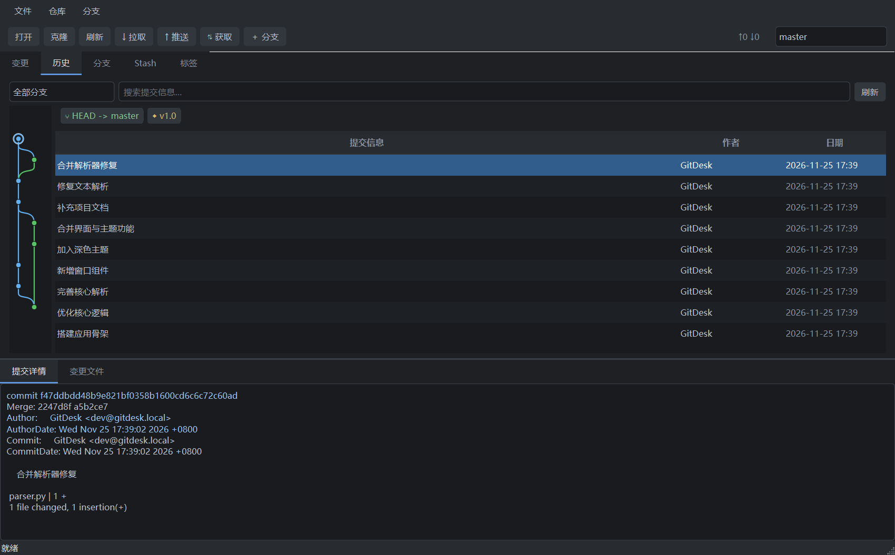
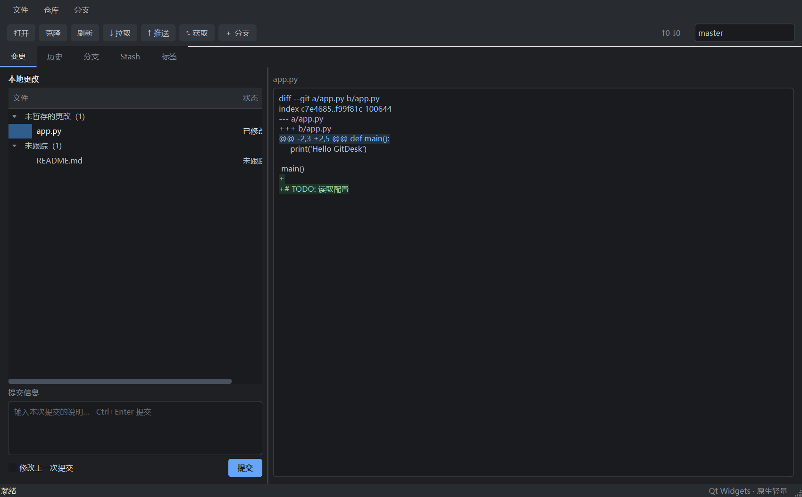

# GitDesk

轻量级原生桌面 Git 客户端，使用 **Python + PySide6 / Qt Widgets**，复刻 PyCharm 的主要 Git 工作流。

- 无 Electron、WebView、Node.js 或浏览器进程。
- 直接调用本机 Git，沿用现有 SSH、凭据、代理与 Git 配置。
- 原生高 DPI、深色主题、彩色分支历史。



## 下载与安装

**推荐从 GitHub Release 下载安装程序，无需预装 Python。**

| 平台 | 下载 | 安装与运行 |
|------|------|------------|
| Windows | [GitDesk Setup.exe](https://github.com/xujc985/gitdesk/releases/download/v1.0.0/GitDesk-1.0.0-windows-x64-setup.exe) | 双击安装，选择目录，使用开始菜单/桌面快捷方式；支持卸载 |
| Linux | [GitDesk AppImage](https://github.com/xujc985/gitdesk/releases/download/v1.0.0/GitDesk-1.0.0-linux-x64.AppImage) | `chmod +x GitDesk-1.0.0-linux-x64.AppImage` 后双击或运行 |
| macOS | [GitDesk DMG](https://github.com/xujc985/gitdesk/releases/download/v1.0.0/GitDesk-1.0.0-macos.dmg) | 打开 DMG，将 GitDesk.app 拖入 Applications |

完整下载页：[GitHub Release v1.0.0](https://github.com/xujc985/gitdesk/releases/tag/v1.0.0)

**需要单独安装 Git。** Release 只提供安装程序及 SHA256 校验文件。macOS 当前为开发签名，正式分发需 Developer ID 签名与 Apple 公证。

## 主要功能

| 工作流 | 功能 |
|--------|------|
| 仓库 | 打开、初始化、克隆、最近仓库、子目录自动定位仓库根 |
| 变更 | 分组变更、暂存/取消暂存、逐块暂存、回滚、未跟踪文件预览、统一/并排差异 |
| 冲突 | 查看 base/我方/对方原文、左右对比、保留我方/对方并标记解决 |
| 提交 | 提交、Amend、无暂存时提交全部、Ctrl+Enter、失败保留草稿 |
| 历史 | 真实父提交拓扑、彩色分叉/合并图、分支与标签徽标、过滤与详情；滚动保留旧分支连线 |
| 分支 | 新建、检出、重命名、删除、合并、变基、上游领先/落后 |
| 远程 | Fetch、Pull、Push、远程地址管理 |
| Stash | 贮藏、预览、Apply、Pop、Drop |
| 标签 | 轻量/附注标签、指定提交、检出、推送、删除 |
| 历史操作 | Cherry-pick、Revert、Reset、Merge、Rebase、继续/中止变基 |



## 从源码运行

要求：Python 3.10+、Git。

```sh
python -m pip install -r requirements.txt
python main.py /path/to/repository
```

Windows 也可以双击 `run.bat` 或 `gitdesk.pyw`；Linux/macOS 使用 `sh run.sh`。

## 构建安装程序

**不能从 Windows 交叉构建 Linux/macOS 原生安装包。** 请在对应系统构建，或使用 CI。

```powershell
# Windows：PyInstaller + Inno Setup，生成 Setup.exe
powershell -ExecutionPolicy Bypass -File .\packaging\build-windows.ps1
```

```sh
# Linux：生成 AppImage
sh packaging/build-linux.sh

# macOS：生成 .app 与 DMG
sh packaging/build-macos.sh
```

首次构建安装依赖：

```sh
python -m pip install -r requirements.txt packaging/requirements-build.txt
```

CI 已配置 Windows / Linux / macOS 构建矩阵。推送 `v*` 标签后，自动创建或更新 GitHub Release 并上传安装程序。详见 [打包发布](docs/打包发布.md)。

## 测试

```sh
python -m unittest discover -s tests -v
```

覆盖真实 Git 仓库、中文/空格路径、彩色分支拓扑、Qt 工作流、线程退出、旧配置兼容和安装程序资源。

Linux 无桌面测试：

```sh
QT_QPA_PLATFORM=offscreen python3 -m unittest discover -s tests -v
```

## 项目结构

```text
main.py                 Qt 启动入口
git_backend.py          Git 命令封装
graph_layout.py         彩色分支拓扑布局
ui_qt/                  原生 Qt 界面、任务调度、主题与资源
assets/                 SVG / PNG / ICO / ICNS 图标
packaging/              安装程序构建与验证脚本
tests/                  后端、Qt、拓扑与平台测试
docs/                   使用、安装与发布文档
.github/workflows/      多平台构建与 Release 流程
```

更多说明：[使用指南](docs/使用指南.md) · [多平台安装](docs/多平台安装.md) · [打包发布](docs/打包发布.md)

## 许可证

MIT，见 [LICENSE](LICENSE)。
